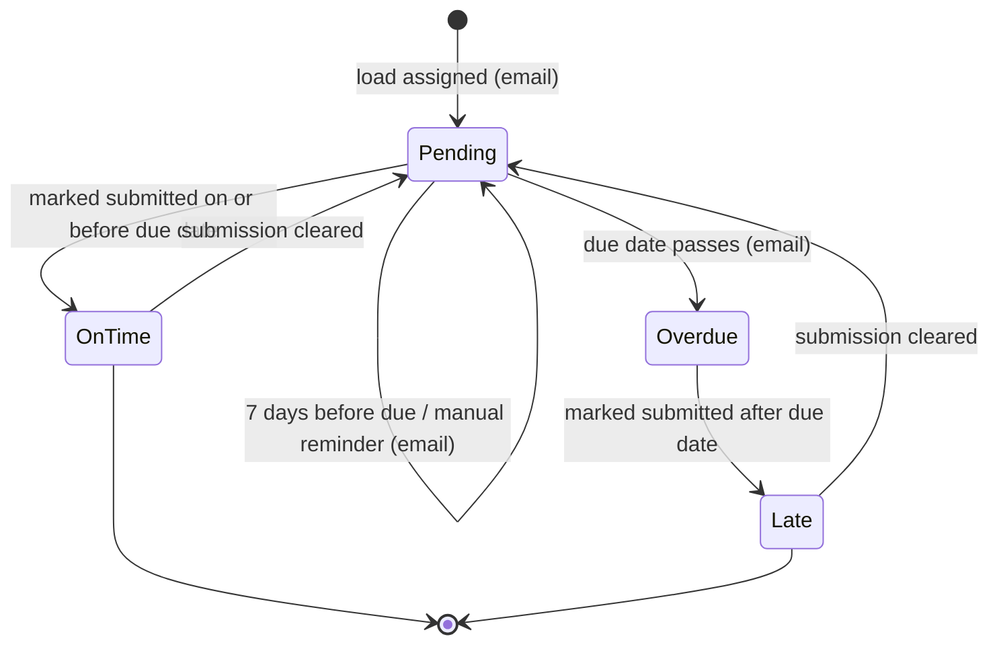
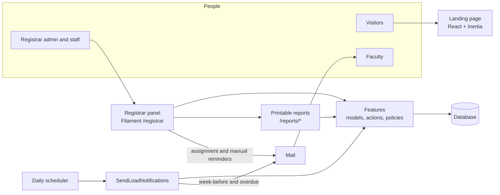
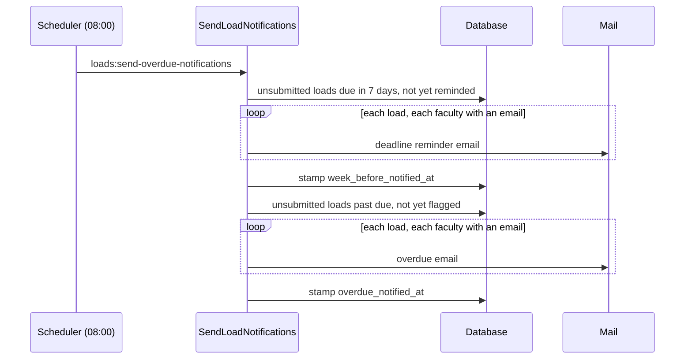
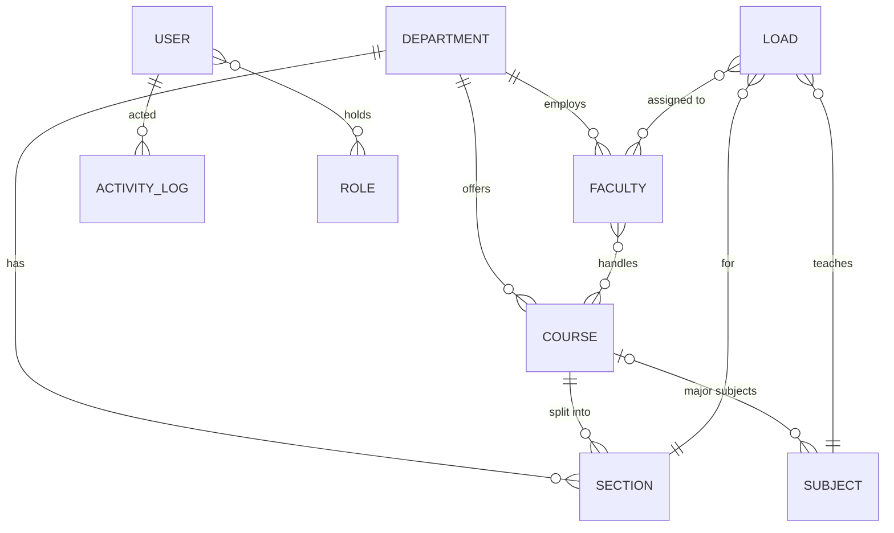

<div align="center">

[](README.md)

</div>

### Overview

At the end of every term, each faculty member owes the registrar a grading sheet for every subject and section they teach. At John Wesley College this was tracked by hand: a logbook of what came in, phone calls for what didn't, and a manual count to find out who was late. The Compliance Monitoring and Reporting System replaces that with one dashboard that knows what is owed, by whom, and by when.

The core idea is that **every grading sheet the college expects is a teaching load with a due date**. Once loads are assigned, the system can tell at any moment what is submitted, what was late and what is still missing, remind the right people automatically, and turn the same data into reports.

The system has two parts:

- **The landing page** (`/`), a public page that introduces the system and leads to sign-in.
- **The registrar panel** (`/registrar`), where registrar administrators and staff manage the academic structure (departments, courses, sections, subjects, faculty), assign teaching loads, record submissions, set deadlines and print reports.

Faculty members never sign in. They are records in the system and are reached by email.

### How It Works

The life of one teaching load, from assignment to submission:

1. **Set the deadlines.** The registrar sets one submission deadline per semester (first, second and summer). A load cannot be created until its semester has a deadline.
2. **Assign.** Staff create a teaching load: a subject, a section, a school year, a semester and one or more faculty members. The load takes its due date from the semester's deadline, and every assigned faculty member with an email address is told about it.
3. **Remind.** Every day at 08:00 a scheduled job emails faculty whose unsubmitted loads are due in exactly seven days. Staff can also send a reminder by hand at any time from the load's row.
4. **Flag overdue.** The same daily job emails faculty once a load's due date has passed without a submission. The load appears in the dashboard's overdue list.
5. **Record the submission.** When a grading sheet arrives, staff switch the load's status on. The system stamps the submission time, and the load counts as *on time* if it was submitted on or before the due date, *late* if after. Switching the status off clears the submission again.
6. **Report.** The dashboard, the load list and the printable reports all read the same status, submission time and due date, so they always agree.



*Overdue*, *On time* and *Late* are not stored. The system works them out from the status, the submission time and the due date.

What the MVP does **not** do: faculty do not upload grading sheets or sign in. The system records *that* a sheet was received, not the sheet itself. Changing a semester's deadline re-dates every unsubmitted load in that semester, across all school years, because one deadline row is shared by all of them.

### Architecture



The backend is a Laravel monolith organised by domain under `app/Features` (departments, courses, sections, subjects, faculties, loads, submission deadlines, reports, users, activity log). The registrar panel is built with Filament and talks to those models and actions directly. The only React page is the public landing page, served through Inertia. The printable reports are plain Blade views behind ordinary routes, so they print cleanly from the browser.

This is what happens when the daily reminder job runs:



**Key decisions**

- **Timing is derived, not stored.** A load stores only whether it was submitted, when, and its due date. *On time*, *late* and *pending* come from shared model scopes, so the dashboard, tables and reports can never disagree.
- **Deadlines are set once and copied onto loads.** Each load keeps its own due date. Saving new deadlines updates only unsubmitted loads, so a load that was already judged on time or late keeps its result.
- **Each automatic email is sent once.** The daily job stamps the load when it sends a reminder or an overdue notice and skips stamped loads, so it is safe to run again.
- **A load can belong to several faculty.** Shared and team-taught classes are common, so loads link to faculty through a join table rather than a single owner, and every assigned teacher is emailed.
- **Faculty are records, not users.** Only registrar staff sign in. Faculty are reached by email, so there are no faculty accounts or passwords to manage.
- **Report logic lives in Actions.** Each report (`GetLoadsReport`, `GetLateSubmissionsReport`, `GetNotSubmittedReport`, `GetFacultyReport`) is one class fed by a validated request, so filters behave the same everywhere.
- **Auditing is automatic.** Every academic model uses one `LogsActivity` trait that records creates, updates and deletes, so no screen can forget to log.

### Domain Model



| Concept | Meaning |
|---|---|
| Department | A college unit (for example the College of Teacher Education), with a code and a badge colour. |
| Course | A degree programme in a department, such as Bachelor of Elementary Education. |
| Section | One class group of a course at a year level, such as BEED1. |
| Subject | A subject with units and a type. A major subject must belong to a course; a minor subject belongs to none and is shared. |
| Faculty | A teacher: department, employment type (full-time, part-time or shared), courses handled and contact details. |
| Teaching load | One subject taught to one section in a school year and semester, by one or more faculty, with a due date and a submission status. |
| Submission deadline | A single record holding the due date for each semester. |
| User | A registrar account that can sign in to the panel. |
| Activity log | A one-line record of who created, updated or deleted which record, and when. |

### Permissions

Access is role-based, managed from the System Roles screen. Only accounts holding the *admin* or *staff* role can open the registrar panel.

| Who | Can |
|---|---|
| Admin | Everything, including registrar accounts and roles |
| Staff | Create, view, edit and delete departments, faculty, teaching loads, sections and subjects |
| Any panel user | View the dashboard, set submission deadlines, and print reports |
| Roles granted the activity log permission | Read the activity log |
| Accounts without a panel role | Nothing: they are kept out of the panel |

### Notifications, Reports and Audit

**Emails** go to every assigned faculty member who has an email address:

- *Assigned*, when a teaching load is created.
- *Reminder*, sent by hand from the load list, naming the staff member who sent it.
- *Deadline reminder*, sent automatically seven days before the due date.
- *Overdue*, sent automatically once the due date has passed.

**The dashboard** can be filtered by school year and semester. It shows on-time, late and pending counts, a bar chart of the faculty with the highest late rates, a submitted-versus-pending chart, the faculty roster by employment type, and a table of overdue loads.

**Printable reports** open as print-ready pages: all loads (filtered by school year, semester, department, faculty, status and timing), late submissions, not-submitted loads, and a per-faculty report.

**Bulk import** fills the academic structure from CSV files: faculty, subjects, sections and courses.

**The activity log** records every create, update and delete on departments, courses, sections, subjects, faculty, teaching loads and submission deadlines, along with the user who made it.

### Stack

| Layer | Technology |
|---|---|
| Backend | PHP 8.3+, Laravel 12 |
| Registrar panel | Filament 4, Filament Shield 4 |
| Roles and permissions | Spatie Laravel Permission 7 |
| Landing page | React 19, TypeScript, Inertia 3 |
| Styling | Tailwind CSS 4, Poppins |
| Build | Vite 7 |
| Database | SQLite by default |
| Email | Laravel Mail, Blade templates |
| Tests and quality | Pest 4, Larastan, Pint |
| CI | GitHub Actions: install, build and the full test suite on every push and pull request |
| Runtime | Docker image: PHP-FPM + NGINX, with a scheduler container for the daily emails |

### Project Map

```
app/
├── Features/<Domain>/          Models, Enums, Policies, Actions, Controllers, Requests, Mail
│   ├── Departments/ Courses/ Sections/ Subjects/ Faculties/
│   ├── Loads/                  teaching loads, notification Action, emails
│   ├── SubmissionDeadlines/    per-semester deadlines
│   ├── Reports/                report Actions, filters, print controller
│   ├── Users/                  registrar accounts and role policies
│   ├── ActivityLog/            LogsActivity trait and log model
│   └── Home/                   landing page controller
├── Filament/
│   ├── Resources/              loads, faculty, sections, subjects, departments, users, activity log
│   ├── Pages/                  dashboard, submission deadlines, reports
│   ├── Widgets/                dashboard stats and charts
│   └── Imports/                CSV importers
└── Providers/Filament/         registrar panel setup and branding
resources/
├── js/                         landing page (React): pages, sections, shared components
├── css/                        landing and panel styles, brand colours
└── views/                      Inertia shell, email templates, printable reports
routes/                         web routes (landing, reports) and the daily schedule
database/                       migrations, factories, the seeder for the first admin
tests/Feature/                  Pest feature tests
docs/                           README screenshots
```
