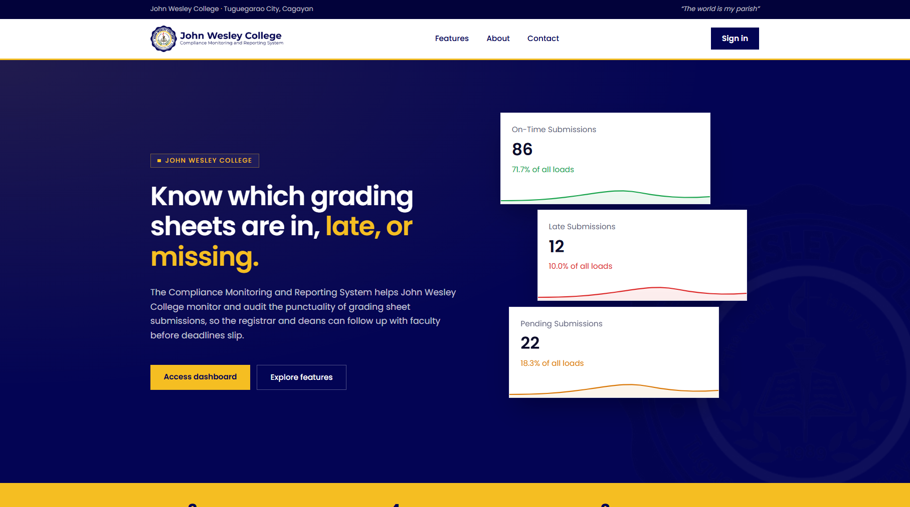
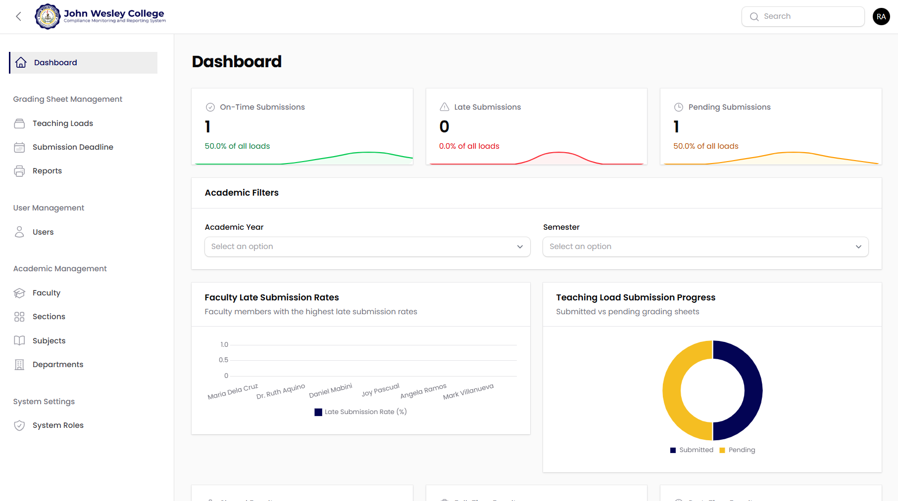
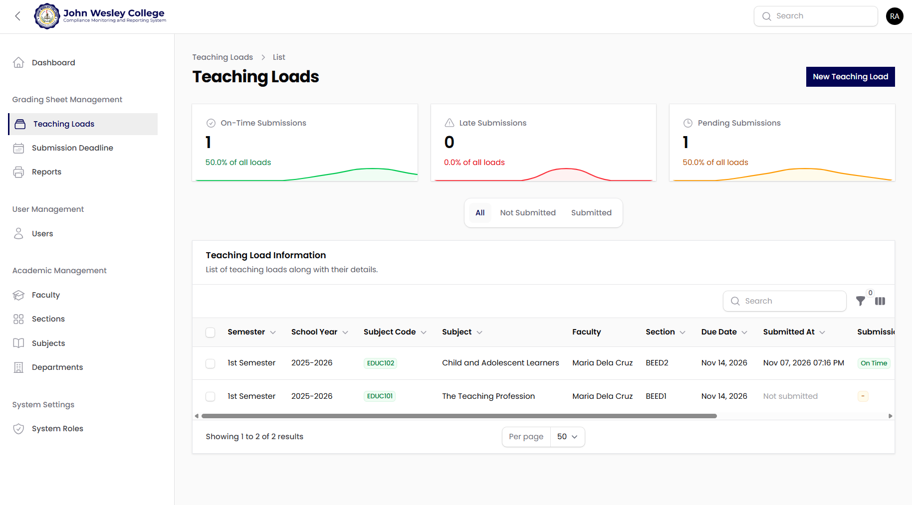
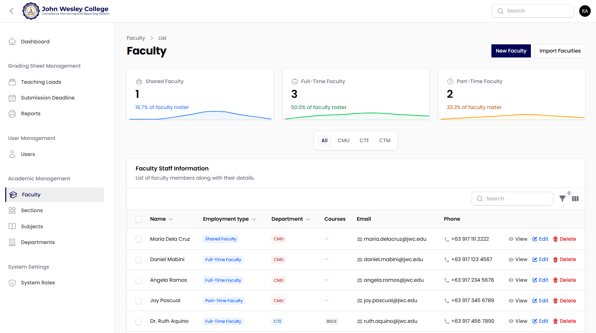

A compliance monitoring and reporting system developed to automate the tracking of faculty grading sheet submissions at John Wesley College, replacing paper logbooks and manual follow-ups with one online dashboard. The system allows registrar staff to assign teaching loads, set submission deadlines and record each grading sheet as it comes in, and gives administrators the tools to spot late or missing submissions, remind faculty by email, and print compliance reports.

### Dashboard

The Dashboard gives the registrar an overview of submission compliance at a glance. It shows how many grading sheets came in on time, late or are still pending, which faculty members are most often late, and which loads are already past their deadline. This replaces counting records by hand at the end of every term, so problems can be spotted and followed up while there is still time.

### Teaching Load Management

The Teaching Load Management page lists every subject and section assigned to each faculty member, together with its deadline and whether its grading sheet has been submitted. Marking a sheet as received takes one click, and the system works out whether it arrived on time or late. Faculty are emailed when a load is assigned, a week before it is due, and when it becomes overdue, replacing phone calls and printed reminders.

### Faculty Profile Management

The Faculty Profile Management page keeps every faculty member's details in one place: department, employment type, courses handled and contact information. Records can be added one by one or imported in bulk from a spreadsheet, making it easy to keep the roster accurate and to link each grading sheet to the right person.

